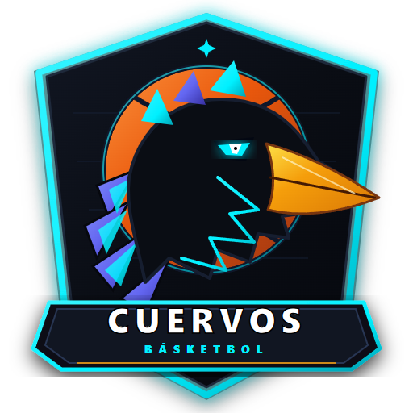

# 🦅 CuervosApp

<div align="center">
  

  **Progressive Web App (PWA) Táctil & Local-First para la Gestión Deportiva del Equipo Cuervos**
  
  [](https://vitejs.dev/)
  [](https://react.dev/)
  [](https://www.typescriptlang.org/)
  [](https://tailwindcss.com/)
  [](https://zustand-demo.pmnd.rs/)
  [](https://web.dev/progressive-web-apps/)
</div>

---

## 📋 Descripción del Proyecto

**CuervosApp** es una herramienta táctica y de sustituciones de alto rendimiento diseñada específicamente para el contexto competitivo del equipo de básquetbol **"Cuervos"**:
- **Contexto de Plantilla**: Contamos con **1 único jugador alto** (*Ancla Central*, Mateo #15, 1.96m) y el resto del equipo somos de estatura promedio pero dotados de una velocidad descomunal.
- **Contexto de Cancha**: Disputamos la liga en **cancha techada al aire libre** de medidas reglamentarias (28m x 15m), con alta propensión a la fatiga en el último cuarto debido a la temperatura y el desgaste físico.
- **Enfoque Visual**: Modo oscuro de **alto contraste** (Obsidiana `#0A0D14`, Cian Eléctrico `#00F0FF`, Índigo Cuervo `#6366F1`, Ámbar Balón `#F59E0B` y Rojo Intenso Rival `#EF4444`) formulado para máxima legibilidad bajo el sol y las luminarias de la cancha.

---

## 🏀 Arquitectura de Módulos

### 1. Pizarra Táctica Interactiva Full-Screen (`TacticalBoard`)
- **Media Cancha Reglamentaria FIBA en SVG**: Proporciones matemáticas exactas a escala (línea de fondo, media cancha, arco de 3 puntos de 6.75m, zona pintada/llave de 4.90m x 5.80m, semicírculo de tiro libre, semicírculo de no carga, bloques de rebote y aro a 1.575m de fondo).
- **Fichas Arrastrables a 60fps con Pointer Events API**: Coordenadas normalizadas `0-100` con `touch-action: none` nativo para arrastre con los dedos en tablets y celulares sin tirones ni scroll del navegador.
  - **5 Fichas Cuervos**: Número dorsal, iniciales, rol y 5 puntos de faltas acumuladas en vivo.
  - **5 Fichas Rivales (O1 a O5)**: Color rojo intenso. Doble toque táctil para asignar etiquetas de scouting instantáneas:
    - 🔥 `Tirador Letal` (Puntear encima, sin flotar)
    - ❄️ `Flotar (No tira)` (Dar 2 metros de distancia para descansar piernas y cerrar pintura)
    - 🛡️ `Poste Rival` (Box-out doble)
  - **1 Balón Naranja 🏀**: Arrastrable para simular la posición de la pelota.
- **Capa de Dibujo Táctico**: Alternancia instantánea entre `Modo Mover` y `Modo Pizarra` para trazar flechas de rotación, pantallas y cortes con el dedo.
- **Motor de Formaciones Defensivas Precargadas**:
  - **Zona 2-1-2 Compacta (Base Q1-Q3)**: Con simulación visual activa de la **Regla del Flote** (el defensor del lado débil se cierra 2 metros a la llave ahorrando piernas).
  - **Zona 1-3-1 Agresiva (Sorpresa Q4)**: Trampas dobles 2v1 en cabecera, bandas y esquinas con el corredor de fondo.
  - **Zona 3-2 Modificada (Anti-Tiradores)**: Regla sagrada donde el ala baja a la esquina y el único poste **nunca sale de la pintura**.
- **Creador de Jugadas por Pasos (Frames)**: Guarda secuencias animadas paso a paso (`Paso 1`, `Paso 2`, `Paso 3`) con interpolación de posiciones.
- **Modo Pantalla Completa Real**: Maximiza la cancha al 100% del viewport eliminando barras del navegador con HUD flotante compacto.

### 2. Plantilla & Motor de Sustituciones Inteligentes ("Plan B") (`RosterManager`)
- **CRUD de Jugadores**: Nombre, dorsal, estatura, atributos del 1 al 10 (`Velocidad`, `Resistencia Física`, `Defensa Interior/Rebote`, `Defensa Exterior/Robo`), estado de asistencia hoy (`Presente`/`Ausente`), faltas (0 a 5) y fatiga (0 a 100%).
- **Motor "Plan B" y Regla Crítica del Poste Alto**:
  - Si cualquier jugador acumula 4 faltas o se cansa, calcula el **Mejor Reemplazo Disponible**.
  - **Protocolo de Emergencia**: Si nuestro único jugador alto (`Ancla Central`, Mateo Torres) sale por faltas o está ausente, el motor detecta automáticamente al jugador promedio con mayor atributo de `Defensa Interior/Rebote` (Tomi Benítez #33 o Joaco Roldán #5) para ocupar el centro de la llave.
  - **1-Click Board Sync**: Botón para volcar automáticamente el Plan B a la pizarra y reacomodar el sistema defensivo a 1-3-1 o 3-2.

### 3. Base de Conocimiento & Bitácora (`KnowledgeBase`)
- **Manual Táctico (Wiki del Equipo)**: Tarjetas editables con el Plan de Dosificación por Cuartos, las 3 Reglas de Oro (*Rebote en Pandilla*, *Verticalidad y Cero Faltas para el Poste*, *Regla del Flote*) y esquemas de contraataque.
- **Bitácora de Partidos**: Desglose cuarto por cuarto (Q1, Q2, Q3, Q4 Clutch), defensa más efectiva y nivel de energía en el último cuarto.
- **Scouting de Rivales**: Fichas de equipos con seguimiento de sus dorsales clave (a quién flotar y a quién presionar).

### 4. Arquitectura Local-First & Respaldo
- Persistencia automática en el navegador mediante `zustand/middleware/persist` (LocalStorage / IndexedDB).
- Función de **Exportación e Importación de archivo `.json` de respaldo** para sincronizar dispositivos en cualquier momento sin internet.

---

## 🛠️ Tecnologías Utilizadas

- **Framework**: React 18 + TypeScript + Vite 6
- **Estilos**: Tailwind CSS 3.4 (Paleta deportiva personalizada de alto contraste)
- **Iconografía**: `lucide-react`
- **Gestor de Estado**: Zustand 5 con middleware `persist`
- **PWA**: `vite-plugin-pwa` con Service Worker para funcionamiento offline completo
- **Interacción**: HTML5 Pointer Events (`onPointerDown`, `onPointerMove`, `onPointerUp`) con `setPointerCapture` y `touch-action: none`

---

## 🚀 Instalación y Puesta en Marcha

```bash
# 1. Clonar el repositorio
git clone https://github.com/p5Patricio/CuervosApp.git
cd CuervosApp

# 2. Instalar dependencias
npm install

# 3. Iniciar el servidor de desarrollo local
npm run dev

# 4. Compilar para producción (typecheck + bundle PWA)
npm run build

# 5. Previsualizar compilación de producción
npm run preview
```

---

## 🦅 Identidad y Paleta de Colores

| Color | Hex | Función Táctica |
| :--- | :--- | :--- |
| **Obsidiana Cuervo** | `#0A0D14` | Fondo de alto contraste antirreflejo |
| **Cian Neón** | `#00F0FF` | Acento principal, fichas Cuervos y líneas clave |
| **Índigo Cuervo** | `#6366F1` | Plumaje secundario y elementos complementarios |
| **Ámbar Balón** | `#F59E0B` | Balón de básquetbol y avisos tácticos |
| **Rojo Alerta** | `#EF4444` | Fichas oponentes O1-O5 y peligro de 4+ faltas |
| **Blanco Nieve** | `#FFFFFF` | Dorsales y líneas reglamentarias FIBA |

---

<div align="center">
  <sub>Desarrollado con rigor arquitectónico para el Club Cuervos Básquetbol.</sub>
</div>
